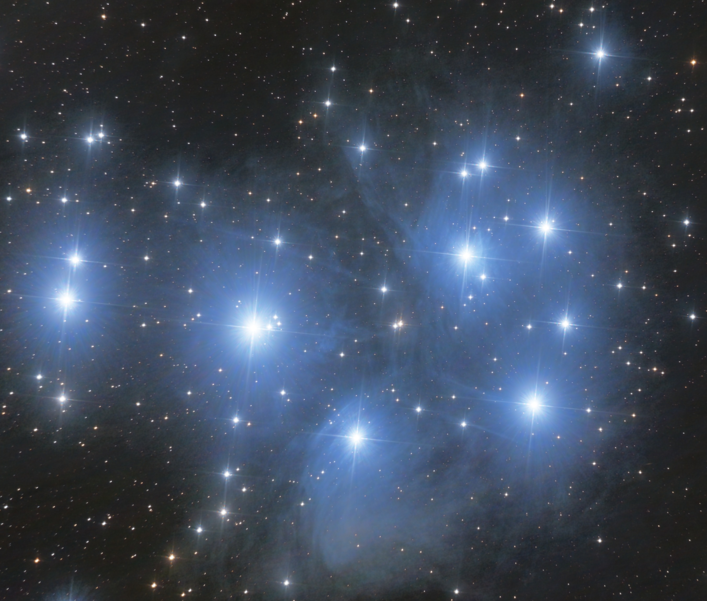
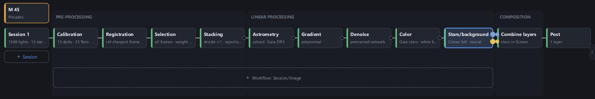
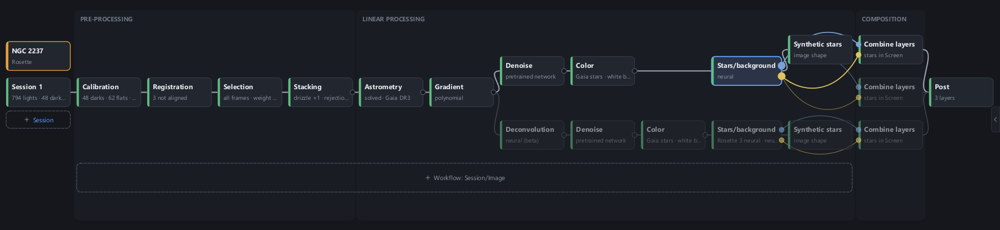
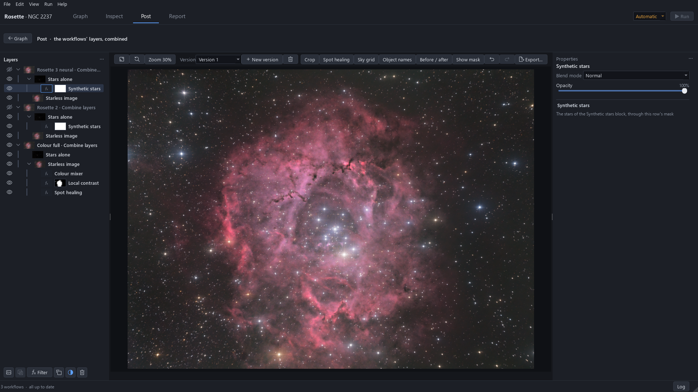

<p align="center"></p>

<h1 align="center">FLOAT</h1>
<p align="center"><b>FLOw for AsTrophotography</b><br>
Deep-sky processing from the raw frames to the final image, as a graph of blocks.<br>
Free software (GPL v3), open weights.</p>


<sub>The Pleiades, 1348 × 13 s, processed in FLOAT from calibration to the final adjustments.</sub>

## The processing graph

Each step, from calibration to post-processing, is a block. The chain is drawn as a graph: it can be read,
modified and run again on the same frames or on another night's.


<sub>One workflow: calibration, registration, frame selection, stacking, plate solving, gradient, denoising,
colour, stars and background, Post.</sub>

- **Partial recomputation.** Each block keeps its result. When a setting changes, only the blocks that
  depend on it are computed again; an interrupted run resumes where it stopped.
- **Several workflows on one graph.** A workflow can branch from any block of another, to try a different
  setting or method. The branches meet in Post, as versions to compare or as layers to combine.


<sub>The Rosette nebula: one stack, three workflows (classic, synthetic stars, neural deconvolution), each sent
to Post as a layer.</sub>

- **Hardware.** An NVIDIA GPU speeds up every step; the processor alone runs the whole chain. 16 GB of RAM
  are enough: a stack larger than memory is processed in parts, with the same result to the bit.

## Licence and openness

- **Free software under the GPL v3.** The code can be used, read, modified and redistributed. No account,
  no subscription, no licence key.
- **Open weights.** The networks used for denoising, deconvolution and star separation ship with the
  program, and the code that trained them is in this repository.
- **No closed-source dependency.** Every library FLOAT is built on is open source; see
  [Acknowledgements](#acknowledgements).
- **Data sources credited.** Each catalogue and survey FLOAT reads is listed in Help › About with its
  licence and the acknowledgement it asks for. Gaia DR3 and the northern-sky H-alpha survey are free for
  non-commercial use.

## Methods

Every method is a published one, cited in the interface next to its settings. Every automatic value comes
with the reason it was chosen.

- **Noise2Noise denoising** (Lehtinen et al. 2018). Each stack is also built as two independent half-stacks;
  the network learns to predict one half from the other, so it keeps only what both halves contain.
  A pretrained network runs in seconds, or adapts to the image on its own half-stacks.
- **Colour calibration on Gaia XP spectra** (Montegriffo et al. 2023; Demleitner & Andrae 2022). The field is
  plate-solved on Gaia DR3 and the sensor's spectral response is rebuilt from the spectra of the stars in the
  image, giving a physical colour matrix with a G2V white.
- **Deconvolution, classic or neural (beta).** Richardson-Lucy (Richardson 1972; Lucy 1974) with the
  handling of saturated stars of Whyte et al. 2014, the star shape measured per zone and per colour; or a
  NAFNet network (Chen et al. 2022) trained against images of the Euclid space telescope.
- **Star separation.** A network on the linear image returns the starless image and the stars alone; the
  two add up to the original image.
- **Bayer drizzle** from the raw colour pixels (Fruchter & Hook 2002), without debayering interpolation, and
  blind plate solving when the target is unknown (Lang et al. 2010).

Full list: [Methods and data](#methods-and-data).

## Post


<sub>Post on the Rosette project: the three workflows as layers, stars and starless image apart, each
adjustment a filter.</sub>

Post follows the layer model of image editors such as GIMP.

- **Layers, masks, blend modes, opacity.** Each workflow's image, and any block's result, can be a layer.
- **Non-destructive.** Each adjustment is a filter on its layer, which can be switched off, changed or
  removed on its own at any time.
- **Tools.** Curves, arcsinh stretch, local contrast, multiscale sharpening and noise reduction, colour,
  crop, spot healing, and several versions of the same edit.

## Test data

Most test sessions come from a 130/900 Newtonian and an uncooled Sony A7S with 15 s frames, some of them
without flats or darks.

| Data | Setup | What it tests |
|---|---|---|
| NGC 7822 | refractor 61 mm, A7S, 602 × 30 s | same image as a careful earlier processing (mean difference 5.6/255); blind plate solving |
| Heart & Soul | refractor 61 mm, A7S, 721 × 15 s | same image as the earlier processing (4.1/255), on an 8 GB GPU |
| Iris nebula | Newton 130/900, A7S, 1242 × 15 s | diffraction spikes kept |
| M33 | Newton 130/900, A7S, no darks, no dithering | strong vignetting, walking noise |
| Horsehead, Flaming Star, Rosette | Newton 130/900, A7S, no flats that night | flats from another night |
| M31 | Newton 150/750, colour camera, 30 × 60 s | strongly defocused stars |

## Installation

16 GB of RAM. An NVIDIA GPU with 8 GB or more is recommended, not required. Colour cameras (DSLR, mirrorless,
one-shot colour) and monochrome cameras with filters.

### With the installer (Windows, recommended)

Download `FLOAT-Setup.exe` from the [releases](https://github.com/n1c1-1/FLOAT/releases) and run it. It installs
FLOAT for your user with everything it needs: its own Python, the plate solver and its index. During the
installation it fetches the star catalogue once (1.85 GB); after that, FLOAT works offline and never downloads
anything while it processes.

### From the sources (Windows 11 or Linux)

Python 3.11–3.12 and [uv](https://docs.astral.sh/uv/):

```
git clone https://github.com/n1c1-1/FLOAT.git
cd FLOAT
uv sync
uv run float
```

The star catalogue is then installed once from Settings › Catalogs & astrometry.

New project → choose a template → choose the frames → Run.

## Known limits

Version 0.1. Neural deconvolution is in beta; monochrome support is younger than colour; Post rendering is
slow on integrated AMD graphics. Tested on Windows 11 with an RTX 4060 Ti, an RTX 3070 and a laptop without
an NVIDIA card. The issues of this repository record what was tried, including what failed.

## Acknowledgements

FLOAT was built by reading the code and documentation of open-source projects:
Siril (stacking rejection, frame weighting, star fitting, background extraction, the generalized hyperbolic
stretch), GIMP (layers and filters), RawTherapee and darktable (demosaicing), DrizzlePac (drizzle and its
coverage rule), Astrometry.net and Asterion (blind plate solving), Astroalign (triangle matching), Source Extractor
(background estimation), GraXpert (gradient removal), DeepSkyStacker (raw frames), NAFNet (network
architecture).

Built on PyTorch, NumPy, OpenCV, Astropy, LibRaw and Qt.

## Methods and data

| Step | Method |
|---|---|
| Registration | triangle matching, Valdes et al. 1995, Groth 1986 |
| Stacking | drizzle, Fruchter & Hook 2002 |
| Plate solving | Bayesian decision of Lang et al. 2010 |
| Colour | Gaia XP spectra, Montegriffo et al. 2023, Demleitner & Andrae 2022 |
| Denoising | Noise2Noise, Lehtinen et al. 2018 |
| Deconvolution | Richardson 1972, Lucy 1974, Whyte et al. 2014; NAFNet, Chen et al. 2022 |
| Star separation | NAFNet, Chen et al. 2022 |
| Post | arcsinh stretch, Lupton et al. 2004; guided filter, He et al. 2013; wavelets, Starck & Murtagh 2006; CLAHE, Zuiderveld 1994; spot healing, Barnes et al. 2009 |

Data: Gaia DR3 (Gaia Collaboration, Vallenari et al. 2023), SIMBAD (Wenger et al. 2000),
VizieR (Ochsenbein et al. 2000), OpenNGC (M. Verga). Each source, its licence and the acknowledgement it asks
for: Help › About in the application.

## For developers

Code organisation: [docs/ARCHITECTURE.md](docs/ARCHITECTURE.md) · tests: [tests/README.md](tests/README.md) ·
command line: `uv run astro-gpu --help`.

## Licence

FLOAT is free software under the GNU General Public License v3: see [LICENSE](LICENSE).
